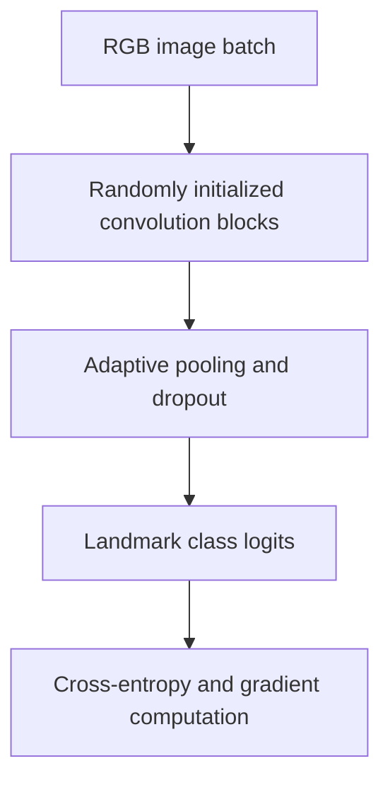

# Landmark CNN Architecture

Build a convolutional image classifier from random initialization and inspect the training behavior of a high-capacity visual model.

## Implementation

Five convolution stages with batch normalization, adaptive pooling, a 256-unit classifier, and configurable class count and dropout.



## Try a small example

Random inputs exercise the released CNN and backpropagation. No trained checkpoint, transfer-learning result or landmark accuracy is established by this example.

After the local setup below, run from the repository root:

```sh
python examples/quickstart.py
```

The [example source](examples/quickstart.py), [captured output](examples/expected-output.txt) and [execution record](examples/environment.json) keep this demonstration inspectable. Floating-point values may vary with library versions.

Observed output from this run:

```text
{
  "fixture": "random RGB tensor, no image accuracy claim",
  "logits_shape": [
    2,
    7
  ],
  "loss": 2.1212432384490967,
  "finite_conv_gradient": true
}
```

## Evidence and results

The repository includes the original baseline architecture and its saved training history. The release validates tensor shapes and gradient flow; it does not claim a newly reproduced image-classification benchmark.

See [VALIDATION.md](VALIDATION.md) for the release checks and their scope.

## Run locally

```sh
python -m venv .venv
source .venv/bin/activate
python -m pip install -r requirements.txt
python smoke_test.py
```

Prepare the inputs described in [DATA.md](DATA.md) first. Source validation is available without installing model dependencies:

```sh
python scripts/validate_source.py
```

Run the focused offline behavior checks with `python smoke_test.py` after installing the dependencies.

## Limitations

This release contains the independently developed baseline experiment. Transfer-learning helpers, application scaffolding, weights, and the full image dataset are outside this source edition.
