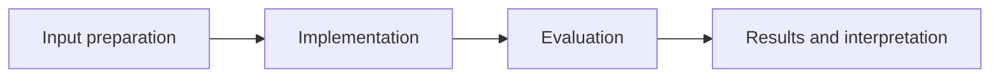

# Landmark CNN Architecture

**Feras Elghandour** · Technical case study

Build a convolutional image classifier from random initialization and inspect the training behavior of a high-capacity visual model.

## Implementation

Five convolution stages with batch normalization, adaptive pooling, a 256-unit classifier, and configurable class count and dropout.



## Evidence and results

The repository includes the original baseline architecture and its saved training history. The release validates tensor shapes and gradient flow; it does not claim a newly reproduced image-classification benchmark.

Results described as saved come from the retained experiment record. See [VALIDATION.md](VALIDATION.md) for the checks performed on this release and their scope.

## Practical relevance

This project demonstrates five convolution stages with batch normalization, adaptive pooling, a 256-unit classifier, and configurable class count and dropout.
The implementation and evaluation make the trade-offs inspectable for technical review.

## Run locally

```sh
python -m venv .venv
source .venv/bin/activate
python -m pip install -r requirements.txt
python smoke_test.py
```

Prepare the inputs described in [DATA.md](DATA.md) first. Source validation is available without installing model dependencies:

```sh
python scripts/validate_source.py
```

Run the focused offline behavior checks with `python smoke_test.py` after installing the dependencies.

## Limitations

This release contains the independently developed baseline experiment. Transfer-learning helpers, application scaffolding, weights, and the full image dataset are outside this source edition.

## Development

Changes should include a clear description of the behavior affected and verification appropriate to that behavior. Keep input data, credentials, model caches, and generated artifacts outside version control.
